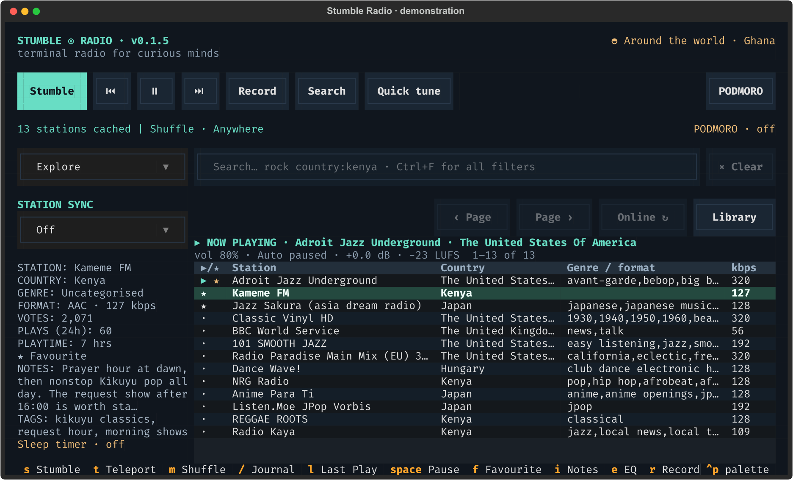

# Stumble, Teleport and shuffle modes

[← Stumble Radio](../README.md)

Screenshots show the actual interface with real stations and demonstration listening data.

The destination and shuffle mode stay above the browser. Here the destination is Japan and the next Stumble will use Music-only; the table itself remains your current library.

Teleport chooses uniformly among countries with eligible cached stations,
animates a spinning destination header, and tunes there. When more than one
country is available, it avoids the currently playing country. Teleport clears
the station-name, country, region, and radius restrictions for the trip; language,
genre, codec, bitrate, and health filters still apply. It explores the public
catalogue, independently of the selected personal library or session shuffle
mode. Stumble uses the current search and selected library, but Teleport does not
honor all active search fields. Search-bound Teleport (keeping the complete result
set as the destination pool) is not currently supported. If the cache is empty,
Teleport can discover countries online and cache candidates on arrival.
The destination remains in the header after landing.

During the spin the header cycles through candidate destinations while playback
stays paused; the app applies only cached, eligible stations.

Hot/Cold learning stays entirely in SQLite:

- Switching away after **less than 10 seconds of measured listening** excludes
  that station from random selection for **24 hours**. Pausing, quitting, a sleep
  timer, and stream errors do not count as a voluntary quick skip.
- Each minute listened adds sampling weight, capped at **10×** the initial weight.
  Sampling stays random; a boosted station is never guaranteed to be chosen.
- Manually listening to a cooled station for **60 seconds** clears its cooldown.
  Explicit search, favourites, and manual tuning always remain available.
- A dead stream has a separate **15-minute** cooldown, without a taste penalty.
- Cooldowns and listening weights survive restarts. Directory sync preserves them.

## Session shuffle modes

Press **m** (shown in the bottom key strip) to cycle the pool used by your *next* Stumble:

| Mode | Eligible stations |
| --- | --- |
| Anywhere | Current library and advanced filters |
| Music-only | Recognised music tags, excluding talk/news/speech/sports tags |
| Talk/News | Tags containing talk, news, speech, or sports |
| Your language | Your saved language, overriding the language search field |
| Nearby | Your saved coordinates and radius, overriding the geographic search fields |
| Hidden gems | Stations with at most 10 votes and 15 clicks, so under-discovered channels surface first |

The active mode appears above the station browser. These modes change random
selection; they do not rewrite the station table's search. Stumble remains bounded
by the current search and chosen library. Teleport follows its own destination
rules described above, rather than the complete result set. Music/talk classification is a heuristic
based on community tags, so untagged or unusual formats can be missed.

Use **Ctrl+G** to set one language name (for example, `english` or `swahili`),
latitude, longitude, and radius. Choosing a mode that needs missing information
opens this form; save it, then press `s`. No IP geolocation or device location is
collected. Settings persist, while the selected shuffle mode resets to Anywhere
on launch. Nearby can match only stations that supply coordinates.

## Sync to the station's daytime

The sidebar has a **Station Sync** dropdown next to the shuffle mode. Choose
*Breakfast Shows*, *Afternoon Shows*, *Evening Shows*, or *Late Night Shows* to
make your next Stumbles land where the local radio day is currently in that
phase: 06–10, 10–17, 17–22, and 22–24 plus 00–06 respectively. The choice is
shown above the browser (for example `Shuffle · Anywhere · Afternoon Shows`),
persists across restarts, and the station chip in the sidebar shows a live
local time for the playing country.

Hours are approximated with one representative timezone per country, so very
large countries (the United States, Russia, Canada) are treated as a whole;
cities outside the representative zone may land an hour or two off. Stations
without a known country cannot be matched and are skipped.

Stumbling with sync active draws up to 64 fresh candidates from the active
pool, keeping list order, and only lands on those whose local hour is inside
the selected window. If none fit, stumbles notify
`No afternoon broadcasts found · landing anywhere` and pick from the unsynced
set instead, so you are never blocked. Teleport is not affected.

Open Ctrl+G to set Your language and Nearby preferences, or adjust the startup/silence timeout.

For automatic retries and dead-stream replacement, see [playback recovery](playback.md#reconnection-internet-outages-and-dead-streams).
To combine a pool with country, genre or other conditions, see [search](search.md).
