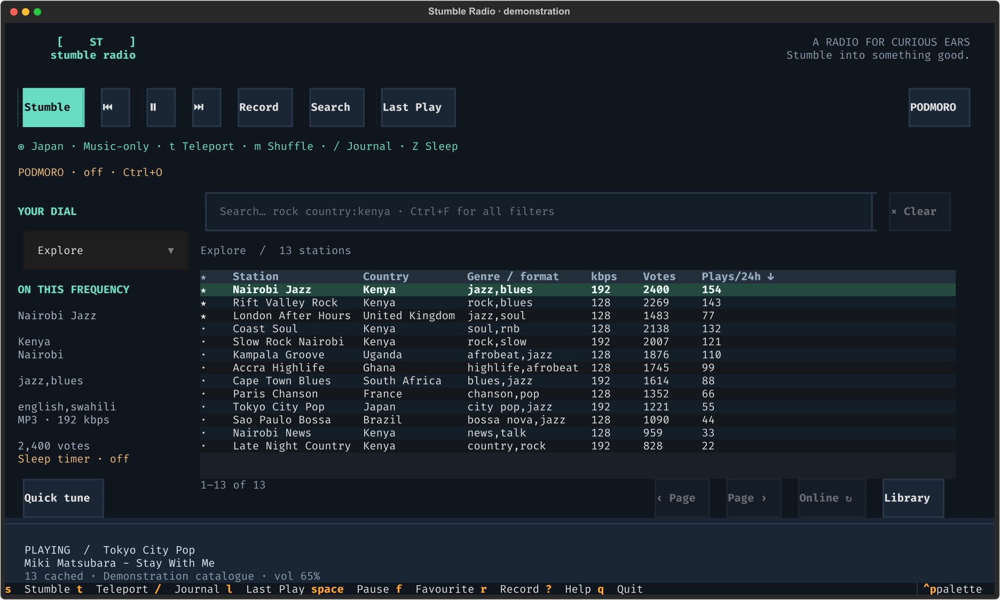
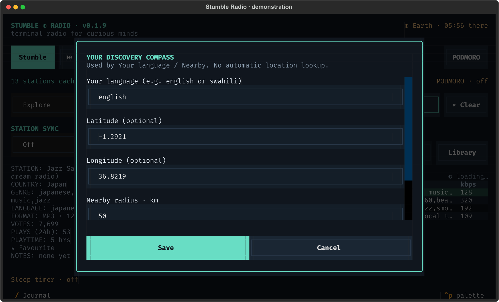

# Stumble, Teleport and shuffle modes

[← Stumble Radio](../README.md)

Screenshots show the actual interface with fictional stations and demonstration listening data.

The destination and shuffle mode stay above the browser. Here the destination is Japan and the next Stumble will use Music-only; the table itself remains your current library.

**Teleport** chooses uniformly among countries with eligible cached stations,
animates a spinning destination header, and tunes there. When more than one
country is available, it avoids the currently playing country. Teleport clears
the name/country/region/radius restrictions for the trip; language, genre, codec,
bitrate, and health filters still apply. It explores the public catalogue,
independently of the selected personal library or session shuffle mode. If the
cache is empty, it can discover countries online and cache candidates on arrival.
The destination remains in the header after landing.

**Hot/Cold learning** stays entirely in SQLite:

- Switching away after **less than 10 seconds of measured listening** excludes
  that station from random selection for **24 hours**. Pausing, quitting, a sleep
  timer, and stream errors do not count as a voluntary quick skip.
- Each minute listened adds sampling weight, capped at **10×** the initial weight.
  Sampling stays random; a boosted station is never guaranteed to be chosen.
- Manually listening to a cooled station for **60 seconds** clears its cooldown.
  Explicit search, favourites, and manual tuning always remain available.
- A dead stream has a separate **15-minute** cooldown, without a taste penalty.
- Cooldowns and listening weights survive restarts. Directory sync preserves them.

## Session shuffle modes

Press **m** (shown in the bottom key strip) to cycle the pool used by your *next* Stumble:

| Mode | Eligible stations |
| --- | --- |
| Anywhere | Current library and advanced filters |
| Music-only | Recognised music tags, excluding talk/news/speech/sports tags |
| Talk/News | Tags containing talk, news, speech, or sports |
| Your language | Your saved language, overriding the language search field |
| Nearby | Your saved coordinates and radius, overriding the geographic search fields |

The active mode appears above the station browser. These modes change random
selection; they do not rewrite the station table's search. Other advanced filters
and the chosen library still apply. Music/talk classification is a heuristic
based on community tags, so untagged or unusual formats can be missed.

Use **Ctrl+G** to set one language name (for example, `english` or `swahili`),
latitude, longitude, and radius. Choosing a mode that needs missing information
opens this form; save it, then press `s`. No IP geolocation or device location is
collected. Settings persist, while the selected shuffle mode resets to Anywhere
on launch. Nearby can match only stations that supply coordinates.

Open Ctrl+G to set Your language and Nearby preferences, or adjust the startup/silence timeout.

For automatic retries and dead-stream replacement, see [playback recovery](playback.md#reconnection-internet-outages-and-dead-streams).
To combine a pool with country, genre or other conditions, see [search](search.md).
