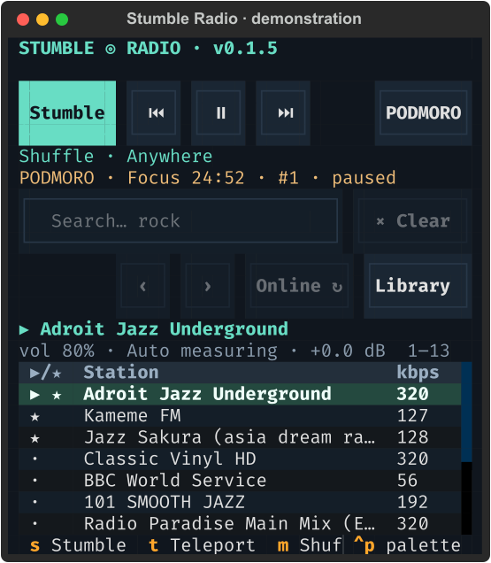

# Install and start listening

[← Stumble Radio](../README.md)

Screenshots show the actual interface with real stations and demonstration listening data.


The station list is in the centre, details are on the left, and playback stays visible along the bottom. The details pane labels every property: `STATION:`, `COUNTRY:`, `GENRE:`, `FORMAT:`, `VOTES:`, `PLAYTIME:` and your `NOTES:` + `TAGS:` for the highlighted channel, with `PLAYTIME: Never played` appearing for stations you have never listened to.

## Quick install

On supported Linux distributions or macOS with Homebrew, install the player and
its dependencies with one command:

```bash
curl -fsSL https://raw.githubusercontent.com/mugendi/stumble-radio/master/install.sh | sh
```

The installer checks `curl`, `tar`, `mpv`, FFmpeg, and `uv`, explains each
dependency, and marks installed tools with a checkmark. For a missing tool it
prints installation instructions and waits while you install it, then checks
again. FFmpeg can be skipped if you do not need recording. The installer never
installs system packages or invokes `sudo`; it installs the app in your user
`uv` environment. On macOS, use [Homebrew](https://brew.sh) to install missing
tools. After installation, run `stumble-radio`.

## Requirements

- Python **3.11 or later**.
- **mpv** on your `PATH` for playback.
- **FFmpeg** on your `PATH` for recording; browsing and playback work without it.
- An internet connection for radio streams and initial station discovery.
- Linux or macOS. On Windows, use **WSL** with working audio forwarding; native
  Windows playback is not implemented because the player uses Unix-domain IPC.

Use a terminal of at least **80 columns × 28 rows**; **110 × 35** gives station
details more room. Keyboard and mouse controls both work. Use **Tab / Shift+Tab**
to move between controls; dialogs and long tables can be scrolled.

The layout also supports compact windows down to **40 × 24**. Long station names
and filter summaries end with an ellipsis; hover to read the full text. As space
shrinks, the sidebar, secondary table columns, and duplicate toolbar shortcuts
are hidden. Keyboard shortcuts still work. The volume and automatic-leveling
status stay below the playing station; the LUFS target and total result count
are omitted when necessary, with the full status available on hover. Resizing
preserves your playlist selection and scroll position.



## Advanced installation

Use these manual steps if you prefer to manage dependencies and the Python
environment yourself. Install the audio tools with your system's package manager:

```bash
# Debian / Ubuntu
sudo apt install mpv ffmpeg

# Fedora
sudo dnf install mpv ffmpeg

# Arch
sudo pacman -S mpv ffmpeg

# macOS
brew install mpv ffmpeg
```

Package availability can depend on your distribution's enabled repositories.
mpv is controlled through its JSON IPC interface, which supports reliable external
pause, volume, metadata, and playback events. FFplay's interactive controls are
less convenient for this purpose. FFmpeg runs separately so a recording can
continue while you pause listening.

## Updates

Stumble Radio checks GitHub for a newer release when it starts and caches the
answer for a day, so at most one small request is made per launch. When a
newer version exists, a toast tells you and the app remembers it: press `U`
(uppercase; lowercase `u` refreshes online filters), confirm, and the app
stops cleanly (without cutting a recording or losing your Podmoro timer),
runs `uv tool install --upgrade` with the same source it was installed from,
then relaunches itself with the new version. A failed update leaves the app
running untouched. If you installed the radio differently (source tree,
pipx), `U` will say to update via that method instead.

## Install globally

Run either installation command **from this project directory**. These install an
isolated Python application and expose `stumble-radio` globally for your user;
you do not need to activate a virtual environment or stay in the project folder.
The project does not need to be published on PyPI.

### Using uv

```bash
uv tool install .
uv tool update-shell
stumble-radio
```

Open a new terminal if the command is not yet on `PATH`. For an editable install
that follows changes in this checkout:

```bash
uv tool install --editable .
```

### Using pipx

```bash
pipx install .
pipx ensurepath
stumble-radio
```

### Without uv or pipx

```bash
python3 -m venv .venv
.venv/bin/python -m pip install .
.venv/bin/stumble-radio
```

This last approach is local to the virtual environment. Use uv or pipx for a
globally available command without modifying system Python.

### Check the installation

```bash
stumble-radio --version
stumble-radio --doctor
```

`--doctor` lists the detected mpv and FFmpeg executables and the actual database
and recordings paths. It does not start audio or contact the directory.

## First launch

1. Run `stumble-radio`. No account, API key, or configuration file is needed.
2. The app starts downloading the catalogue in batches in the background. The
   status line shows how many stations are cached. You can use the app immediately.
3. Press **s** to stumble into a station, **t** to teleport, or **Ctrl+F** for advanced search.
4. Select a row with the arrow keys and press **Enter** to play it.
5. Press **f** to save the highlighted station to favourites.
6. Choose **Favourites**, **History**, or **Unheard** from the library dropdown.

On a fresh empty cache, Stumble can ask the API for random candidates without
waiting for the full catalogue. Search starts locally: use **Online ↻** / **u**
in Explore to fetch matching stations before the background download reaches them.
The app never autoplays on launch. The station you last heard shows as a
`▶ LAST · … · Space resumes` chip so one keypress picks it up again.

See the [keyboard controls](playback.md#controls), [search guide](search.md), and [troubleshooting guide](troubleshooting.md).
