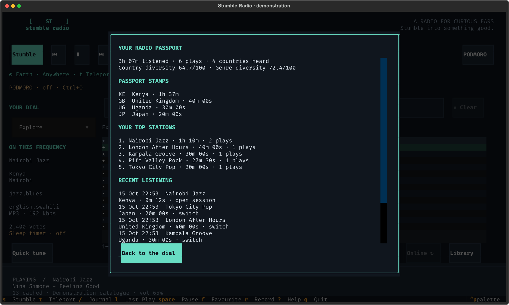

# Listening journal and radio passport

[← Stumble Radio](../README.md)

Screenshots show the actual interface with fictional stations and demonstration listening data.

Press / to see where your listening time has gone. Passport stamps identify countries heard, and top stations rank your measured time rather than directory popularity.

Press **/** for your journal. It shows total measured listening time, play count,
the ten stations you have spent the most time with, the latest 100 sessions, and
country passport stamps with listening time. Playback continues while it is open.
Close and reopen it to refresh the snapshot.

Time accumulates while playback is active; pause and buffering are excluded.
Detected silence is excluded when decoded audio metering is available. Listening is
checkpointed every five seconds and on station changes, journal opening, sleep,
and normal exit. A crash can lose the last few uncheckpointed seconds. Stations
enter history when their stream loads; failed startup attempts do not earn a
passport stamp. A country is stamped once measured listening time is positive.

Country and genre scores use **Simpson diversity**, expressed as
`100 × (1 − Σ share²)`. Zero means one category; the score approaches 100 as time
spreads evenly over more categories. Genre time is split equally between each
station's distinct tags. Unknown countries and empty tags are omitted from the
corresponding diversity calculation.

Per-station totals, learning weights, and passport stamps persist beyond the
5,000-event history window. Existing databases upgrade automatically, preserving
favourites and history. Older play events remain visible, but their duration is
unknown and is not invented retroactively.
For remembered songs and artists, use [Last Play Search](last-play.md). The journal measures stations and listening time; Last Play stores broadcaster track metadata.
