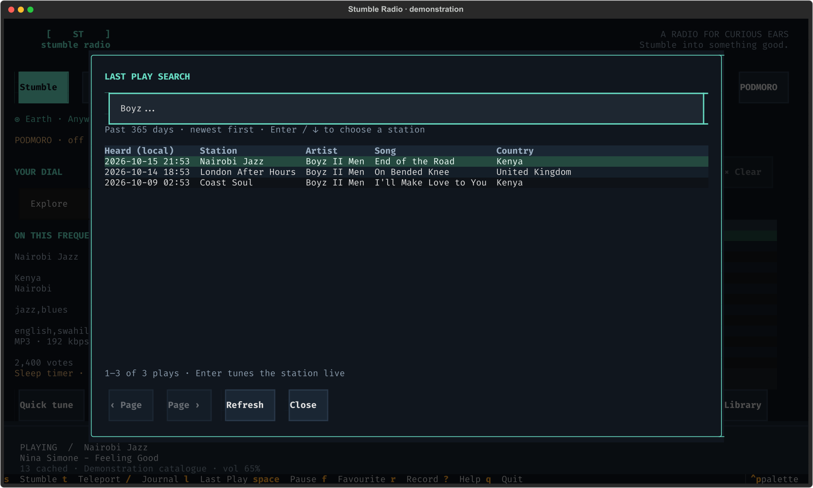

# Last Play Search: find that song again

[← Stumble Radio](../README.md)

Screenshots show the actual interface with fictional stations and demonstration listening data.

Search an artist, song or station. Each row is a listening occurrence; selecting it tunes the station live. The screenshot uses example plays, not actual broadcast claims.

Press **l**, **Ctrl+L**, or the **Last Play** button. Stumble Radio saves song
metadata as you listen, so you can find which station played a track days or
months later. Playback continues while the search window is open.

For example, enter `Boyz` or `Boyz...` to find Boyz II Men tracks. Results show the
listening date and time in your local timezone, station, artist, song, and country,
ordered by **most recent play first**. Each listening occurrence is a separate
result, including the same song heard again later or on another station.

- Search words match **word prefixes** across artist, title, original ICY track
  text, and station name. `boyz bended` requires both prefixes somewhere in the
  entry; `beyonce` also matches `Beyoncé`. This is word-prefix search, rather than
  arbitrary substrings inside a word.
- Punctuation such as the dots in `Boyz...` is ignored. Quotes and words such as
  `OR` are treated as ordinary search text; the station search bar's field and
  boolean syntax does not apply here.
- Clear the input to browse recent songs. Results have **100 entries per page**;
  use the page buttons for older matches. **Refresh** reloads plays captured while
  the window is open.
- Press `Enter` or `↓` from the input to focus results, then `Enter` on a result
  to **tune its station live**. This does not replay the historical song or create
  an audio recording. Escape closes the window.

Artist/title tags and common ICY `Artist - Title` announcements are supported.
Unsplit announcements remain searchable as song text, with an unknown artist.
Repeated notifications for the same current track are suppressed. Tracks announced
while paused or buffering are saved when playback resumes. Station names and
stream URLs used by mpv as display fallbacks do not create song-history entries.

This depends on **metadata supplied by the broadcaster**: a stream without song
tags cannot supply song history, and inaccurate tags are preserved as provided.
There is no audio fingerprinting, microphone access, or external song-identification
service. History starts after installing this feature; older listening sessions
cannot be reconstructed into songs.

The local SQLite database stores entries in `track_plays`, with an **FTS5 index**
for search and a timestamp index for expiry. Entries older than a rolling **365
days** are deleted on startup and hourly while the app is open. Expired entries
are excluded from search immediately, including between cleanup runs. Deletion
also updates the full-text index. This retention applies to song history, leaving
favourites and listening totals intact. SQLite reuses freed space; deleting rows
does not necessarily shrink the database file on disk.
The [station search syntax](search.md) applies to the main browser, not this song-history search.
