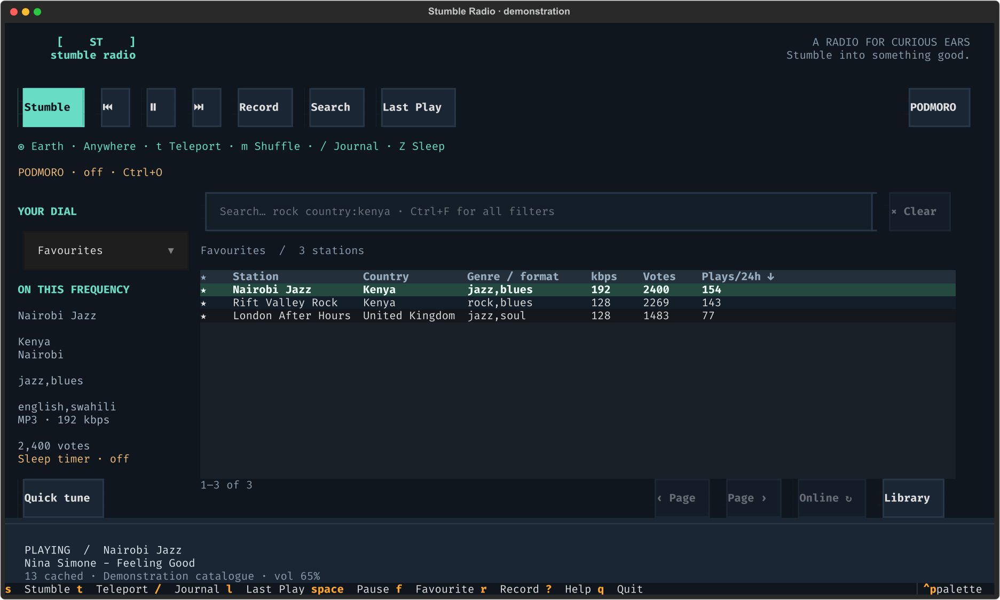
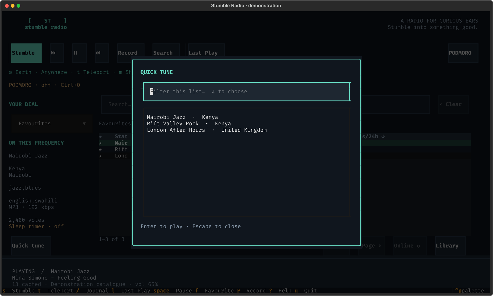

# Favourites, browsing and local storage

[← Stumble Radio](../README.md)

Screenshots show the actual interface with fictional stations and demonstration listening data.



Choose Favourites to see your saved dial. Switching libraries clears search restrictions; saved stations are kept across restarts.

## Your dial

Highlight a station and press **f** to add or remove a favourite. This acts on the
highlighted row, which can differ from the playing station. Matching favourites
appear first in station lists, including search results. Sorting the ★ column
explicitly lets you put them last instead.

Use the sidebar dropdown or the **Library** button to choose:

| Library | What it shows |
| --- | --- |
| Explore | The cached public directory, with failed checks hidden by default |
| Favourites | Your saved stations, including entries now marked broken or absent |
| History | Stations you have played, initially ordered by most recent within each favourite group |
| Unheard | Stations you have never played, based on persistent play totals |

Each page holds up to 100 distinct streams. Use **‹ Page / Page ›** or **[ / ]**
to browse. Changing libraries clears the search so a previous filter does not hide
your saved stations. Playback continues while you browse.

## Quick tune



Ctrl+B opens a small picker for the current results page. Type to narrow its choices and press Enter to play one.

Quick tune searches the current page. Use the [main search bar](search.md) to search the entire cached catalogue.

## Local database and background sync

SQLite is intentional: it provides a durable personal library, quick local
filtering, and directory browsing when API mirrors are unavailable. Playback
still needs access to each station's stream.

### Duplicate station records

Radio Browser can contain several UUIDs for exactly the same playback URL.
Station lists display **one row per exact cached playback URL** (`url_resolved`
when the API provides it, otherwise `url`). The database retains every API UUID
for syncing and personal history; a URL index supports grouping without deleting
or replacing your existing records.

Filters apply first, then matching records sharing a URL are grouped **before
sorting and pagination**. Result counts and page sizes therefore count distinct
streams. Within a matching group, the representative is chosen by a successful
last stream check, then a directly favourited record, then highest votes, then
UUID for a stable tie-break. Sort values come from that representative; duplicate
records' votes and directory play counts are not summed.

Favourites apply to every alias of the same URL. Removing a favourite removes its
saved aliases too. History and Unheard recognize plays through any alias, and
the journal's top stations combine their listening time. Stumble samples each URL
once, combines its listening time for weighting, and respects cooldowns and current
station exclusions across aliases.

Different URLs remain separate, including MP3/AAC variants, HTTP/HTTPS endpoints,
and URLs with different query parameters. The app does not follow every stream's
redirects or compare audio to guess which URLs carry the same programme. Entries
with no URL remain separate because an empty URL does not identify a stream.
The status line's cached-record count includes API aliases; station-list totals
count the matching distinct streams.

### Sync behaviour

- On startup, a stale or missing catalogue starts syncing without blocking the UI.
- The app discovers Radio Browser mirrors, picks a random mirror order, and retries
  other discovered mirrors on request failures. It sends `StumbleRadio/0.1.0` as
  its descriptive User-Agent and always bounds station requests with a limit.
- Full downloads use **1,000 records per batch**, with a brief pause between batches.
  Broken station entries are cached too; Explore and Unheard hide them by default.
- Each batch and its next offset commit in one SQLite transaction. Closing the
  app preserves progress; a download started less than 24 hours ago resumes next time.
- After a successful full scan, the catalogue is considered fresh for **24 hours**.
  While the app remains open, it checks hourly whether another scan is due.
- If sync fails, existing records remain usable and sync retries after five minutes.
  There are no repeated sync failure popups. The status line reflects the failure.
- Online search candidates are immediately merged by station UUID into the cache.
  Each request fetches a page of 100 candidates. Boolean queries may combine
  several bounded pages; the complete local expression decides which stations appear.
- Successful scans mark unseen records as absent from the public catalogue. They
  retain those records, favourites, and history so personal data is preserved.
- Downloads are paginated by name against a changing, mirrored directory. They
  provide an eventually consistent cache, not an atomic snapshot; directory changes
  during pagination may cause omissions until a later refresh.
- Background sync runs **only while the TUI is open**. There is no daemon, cron
  job, or separate service to install.

SQLite uses WAL mode and short-lived worker-thread connections, so database work
does not block input or audio controls. The app's async API requests also run
outside the UI message handlers. Search terms are bound SQL parameters, and sort
columns are restricted to known fields.

## Files and command-line options

Default data location:

| Platform | Directory |
| --- | --- |
| Linux | `$XDG_DATA_HOME/stumble-radio` or `~/.local/share/stumble-radio` |
| macOS | `~/Library/Application Support/stumble-radio` |

The directory contains `radio.sqlite3`, SQLite's transient WAL files, a
`recordings/` subdirectory, and the default `pomodoro/audio/commands/` voice
library. The database holds favourites, listening and song history, learning
preferences, and Podmoro profiles, schedules and checkpoints. These do not require
a separate account or cloud service. No telemetry is added.
When online, a successful play sends the directory's standard click notification.

```bash
stumble-radio --help
stumble-radio --version
stumble-radio --doctor
stumble-radio --offline
stumble-radio --data-dir /path/to/library
stumble-radio --recordings-dir /path/to/recordings
```

`--offline` disables **all directory API requests**, including catalogue sync,
online search, and play notifications. It does not disable network audio streams;
stations saved in the cache remain playable when their streams are reachable.
An empty offline cache has no stations to display.

### Back up or reset

Close the app before copying the entire data directory. Restoring it restores
the catalogue, favourites, listening totals, song history, and Podmoro settings.
The default voice clips and recordings are included in that directory. Copy them
separately if you selected an alternate voice library or recordings folder;
restore alternate folders at the configured paths or update those paths.
Removing the database resets saved station data and scheduler settings; back it
up before resetting anything.

### Uninstall

```bash
uv tool uninstall stumble-radio
# or
pipx uninstall stumble-radio
```

Uninstalling the application leaves your database and recordings in place.
