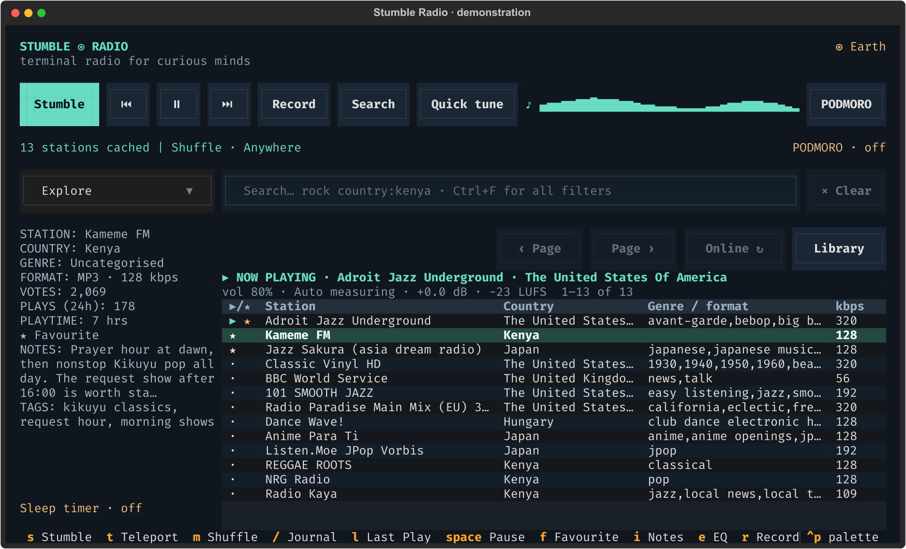
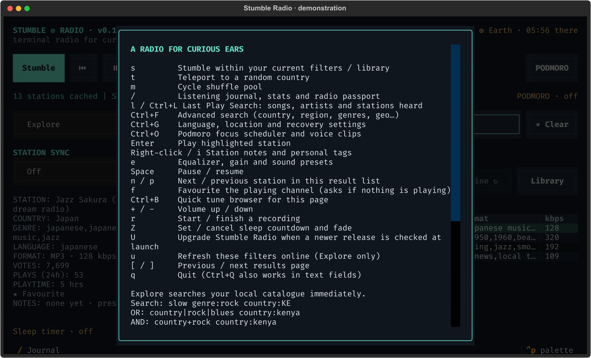
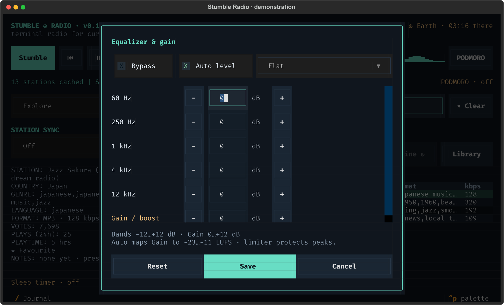
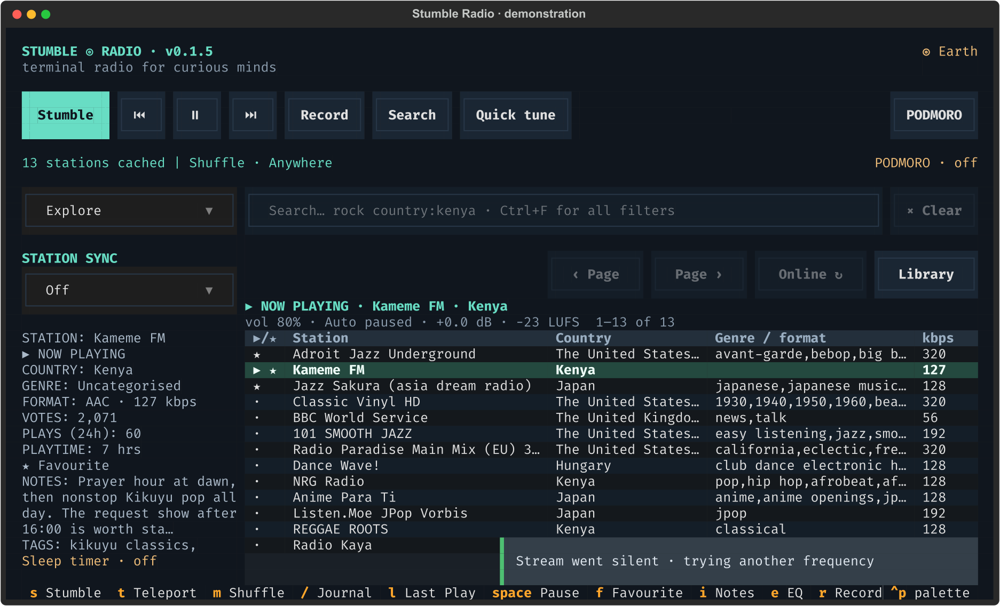
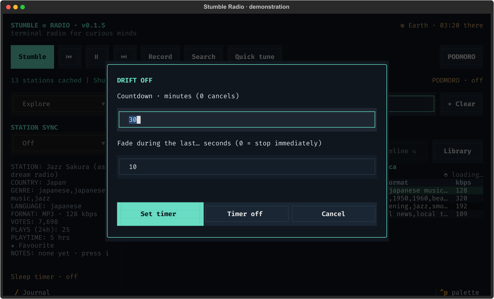
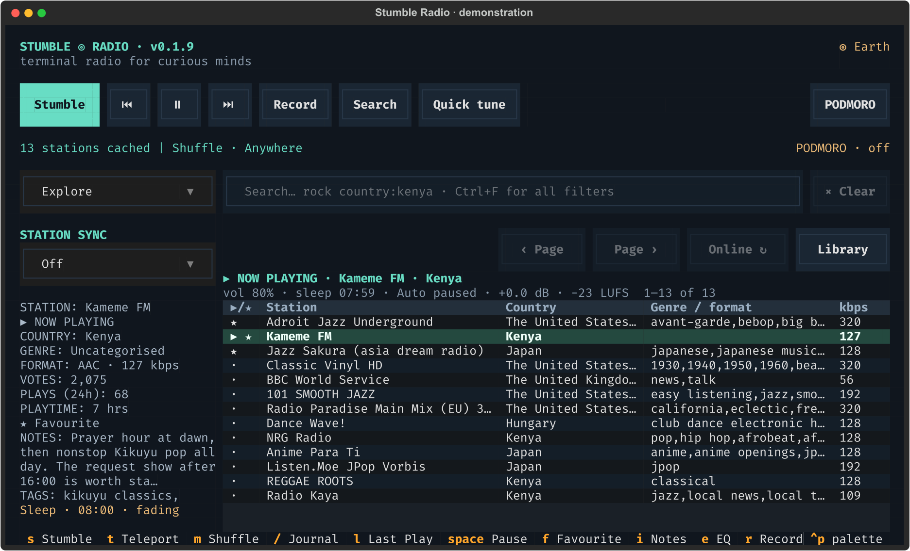
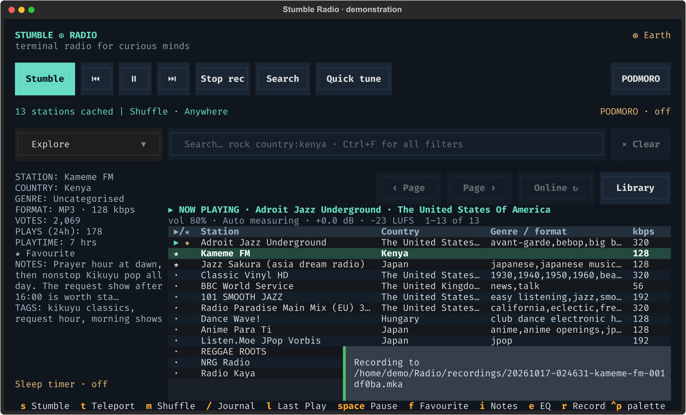

# Playback, recording and sleep

[← Stumble Radio](../README.md)

Screenshots show the actual interface with real stations and demonstration listening data.



Use the top controls or keyboard shortcuts. The centre media icon switches between Play and Pause; the bottom panel follows the playing station while you browse.
Quick tune sits beside Search, while PODMORO is right aligned; Last Play stays one keypress away with `l` or `Ctrl+L`. On narrow terminals, PODMORO moves to the right side of the second control row.

Switching stations is gapless: while the new channel buffers in a second player, the
current one keeps playing, and the swap only happens once the next stream can start.
The status bar shows a right-handed `loading…` spinner while this transfer is under
way, and the same slot reports `buffering…` when mpv pauses for cache.

## Controls

Single-letter shortcuts apply outside text fields. When typing into an input,
letters and spaces enter text normally. Press `Tab` or `Enter` to return to the
station list. `Ctrl+Q` quits even while an input has focus.

| Key | Action |
| --- | --- |
| `s` | Stumble within current filters and library |
| `t` | Teleport to a random country and station |
| `m` | Cycle the session shuffle pool |
| `/` | Open listening journal, stats, and radio passport |
| `l` / `Ctrl+L` | Open Last Play Search; Ctrl+L works inside inputs |
| `Ctrl+F` | Open advanced search (also the Search button) |
| `Ctrl+G` | Set preferred language, location, and recovery timeout |
| `Ctrl+O` | Open the right-aligned PODMORO scheduler button |
| `↑` / `↓` | Highlight a station |
| `Enter` | Play the highlighted station |
| Right-click a station / `i` | Edit station notes and personal tags |
| `e` | Open equalizer, gain and presets |
| `Space` | Pause/resume; play the selected station if stopped, or resume the last-heard station at launch |
| `n` / `p` | Next/previous station within the visible results page, wrapping at the ends |
| `f` | Favourite the **playing** channel; if nothing is playing, confirm before acting on the **highlighted** station |
| `Ctrl+B` | Open the quick tune picker for this results page |
| `+` / `-` | Raise/lower volume by 5 |
| `r` | Start or finish recording the **playing** station |
| `Z` / `z` | Set or cancel a sleep countdown and fade |
| `U` | Update the app when a newer release is available (checked at launch) |
| `u` | Fetch another online results batch for Explore's current filters |
| `[` / `]` | Previous/next page (100 stations per page) |
| `?` | Show help |
| `Escape` | Close a dialog |
| `q` / `Ctrl+Q` | Quit and finalise any recording |

The transport buttons use **⏮** (previous), **▶** (play/resume), **⏸** (pause), and
**⏭** (next). The centre button shows the available action and switches as playback
changes; hover over an icon for its label and shortcut. **Library** cycles through
Explore, Favourites, History, and Unheard; it remains available on narrow terminals
where the sidebar is hidden. A library change clears filters so saved stations
are easy to find. The **Quick tune** button beside **Search** opens the
quick picker; its text box filters the current page, and you can use the
main search or advanced filters to search the entire catalogue.

Space also picks up where you left off: at launch it resumes the last station
you heard, shown before playback starts as a `▶ LAST · … · Space resumes` chip
in the sidebar.

Press **?** for a help overlay with these shortcuts and a few search examples.



## Equalizer and gain

Press **e** to open the equalizer. One saved setup applies to
all stations, including after changing stations, reconnecting, or restarting.



- Adjust **60 Hz, 250 Hz, 1 kHz, 4 kHz, and 12 kHz** from **−12 to +12 dB**.
- **Gain / boost** adds **0 to +12 dB**, separately from the normal volume control.
- **Auto level** is enabled by default and balances stations toward a shared loudness target. Turn it off in the equalizer when you prefer station levels to vary. With it enabled,
  Gain sets the target from **−23 LUFS** (0) to **−11 LUFS** (+12); for example,
  +6 targets **−17 LUFS**. The bottom status bar reports the target and current
  correction, or whether it is measuring, waiting for audio, paused, or unavailable.
- Type a whole number or use the minus/plus buttons for 1 dB steps. The fields
  scroll on smaller terminals; Save and Cancel remain below them.
- **Flat**, **Bass boost**, **Speech**, **Rock**, **Pop**, **Jazz**, and **Classical**
  presets change the EQ bands while keeping your gain setting. Band settings that
  do not match a preset show **Custom**.
- **Bypass** temporarily disables both EQ and gain without losing their values.
  **Reset** enables processing with flat bands, zero gain, and automatic leveling.

Changes preview live after a 200 ms pause in editing. **Save** or **Ctrl+S** keeps
the setup; **Cancel** or **Escape** restores the sound from when you opened the
editor. Invalid values leave the last valid sound playing. A save error keeps
your draft open for retry or cancellation. Changes can briefly reconfigure the
audio filter without retuning the station or restarting a recording.

With EQ, gain, or automatic leveling active, a peak limiter caps digital sample
peaks at **−1 dBFS** without automatic makeup gain.
Boost helps quieter streams; already-loud streams may sound compressed. Flat EQ
with zero gain and Auto level turned off is unprocessed. Normal volume, pause, sleep fading, and Podmoro
voice volume remain independent. Master volume is saved automatically and
restored on the next launch (65% on first use). Recordings retain the original stream, and
silence detection and the audio meter measure the source before EQ and gain.
Automatic leveling measures three-second short-term loudness after EQ, starts each
station at 0 dB correction, and moves gradually to avoid sudden jumps. It freezes
on silence and while playback is paused or buffering. Its correction is limited to
−36…+24 dB. The target is a practical shared listening level, not broadcast
normalization: stations with extreme loudness differences may reach the correction
limit, and the limiter can compress peaks on heavily boosted audio. If mpv cannot
provide loudness metadata, playback continues with normal EQ and gain, and the
status reports leveling as unavailable.

The equalizer uses mpv's audio filters. An unsupported build or rejected filter
shows an error and restores working sound; restored settings that cannot be
applied are bypassed so playback can continue. Voice prompts use their separate
player and are unaffected by EQ.

## Reconnection, internet outages, and dead streams



A staged recovery: the current stream went silent, so the app keeps the station
selected and tries another frequency. No dead stream was contacted for this capture.

Every station has automatic reconnection, including manually selected stations
and favourites. If a playing stream ends, disconnects, or stalls, the app retries
**that same station indefinitely**. A lost mpv connection also restarts the player.
Retries wait **1, 2, 4, 8, 16, then 30 seconds**, capped at 30 seconds between
subsequent attempts. Each attempt also needs time to connect/load. A successful
reconnection resets the delay for the next interruption and restores your volume.

When playback fails, lightweight TCP checks test the station host and Radio
Browser's bootstrap host in parallel, with a three-second timeout. These checks
download no audio or directory data and run only during recovery. If both hosts
are unreachable, the player shows **WAITING FOR NETWORK** and checks again every
**five seconds** after the probes finish. As soon as either becomes reachable, it
tries the current station immediately. Reachability checks are a network estimate;
a reachable host can still refuse a particular stream, which then keeps retrying.
`--offline` disables directory sync/API queries; streaming and these connection
checks still use the network.

During an outage, Stumble stays on the current station and does **not** blacklist
it, spend replacement attempts, or cycle through other stations. It also retries
the same station if an outage prevented the initial stream from loading.

Stumble and Teleport still skip an online station that **never starts**, or whose
decoded audio stays below **−50 dB RMS**. Detection uses mpv's FFmpeg `astats`
filter, rather than missing song titles or speaker volume. If metering is
unavailable, errors and position/stall checks still operate. Manually chosen
stations keep retrying connection/startup failures and are not skipped for silence.

The default timeout is **12 seconds**, configurable from **3–120 seconds** with
`Ctrl+G`. Checks run about once per second, so recovery may take slightly longer
than the configured threshold. Pressing **Space / Pause** during reconnection or
an outage suspends retries; press it again to resume that station. Changing
stations cancels the previous retry. Sleep expiry and quitting cancel retries too,
so playback cannot restart afterwards. A sleep countdown keeps running offline.
Changing the shuffle mode affects your next Stumble; dead-stream replacement
retains the original pool or Teleport country.

Recovery avoids failed candidates, can fetch more candidates online, and allows
up to **eight consecutive replacements** for dead/silent Stumble candidates. A
stream that stays healthy for twice the timeout resets that budget. If that pool
is exhausted, playback stops with a message. This budget does not limit same-station
reconnection. A missing mpv installation or invalid stream URL reports an error
instead of repeatedly attempting an unusable local setup.

Reconnecting finalises any existing recording, just as a manual retune does;
recording does not restart automatically. Press Record after playback returns to
start a new file. Interrupted time does not count toward listening totals. Quiet
programmes can trigger Stumble's silence threshold; raise the timeout or manually
tune that station if needed.

## Sleep countdown and fade



Set the total listening time and the final fade separately. Timer off cancels an existing countdown.

Press **Z** (or `z`) to enter minutes and the final fade duration. For example,
`30` minutes with a `10` second fade gradually lowers volume during the last ten
seconds, then stops both playback and recording. Countdown limits are 0–1,440
minutes; fade limits are 0–300 seconds, capped at the countdown duration. A fade
of zero stops immediately when the timer expires.

The remaining time appears in the status line and sidebar. Use **Timer off** to
cancel. Cancelling during a fade or completing the timer restores the original
volume for the next playback. Expiry also cancels pending Teleport/recovery work,
so automatic discovery does not start another station after bedtime. Timers are
session-only and are not restored after restarting the app.



While the countdown runs, the sidebar shows the remaining time and fade state,
and the status line shows when the fade begins.

## Recording

Press **r** while listening to begin recording. Press **r** again to finish.
Files use a timestamp, a sanitised station name, and a unique suffix:

```text
20261015-213500-Example-Jazz-a1b2c3.mka
```

Recordings contain the original audio stream in a **Matroska audio (.mka)**
container. Stream copying avoids quality loss and works with common radio codecs
without guessing the correct filename extension. You can play the result in mpv
or VLC, or remux/convert it with FFmpeg when needed.



While recording, the transport button shows **Stop rec** and a toast names the
file being written; the demo path here is illustrative.

- Recording opens a **separate connection** to the same stream. It uses additional
  network bandwidth; stations with connection limits may reject that connection.
- Pausing playback **does not pause recording**.
- Switching stations stops and finalises the current recording; press `r` to
  record the new station.
- Quitting normally or finishing the sleep timer finalises the recording too.
- A stream or disk failure is reported. A forced process kill or power loss may
  leave an incomplete file. There is no built-in duration or disk-space limit.

To extract MP3 audio from a recording whose source codec is MP3:

```bash
ffmpeg -i recording.mka -c:a copy recording.mp3
```

For a different source codec, choose a compatible container or re-encode explicitly.

Recording destinations and command-line overrides are in [library and storage](library.md#files-and-command-line-options).
