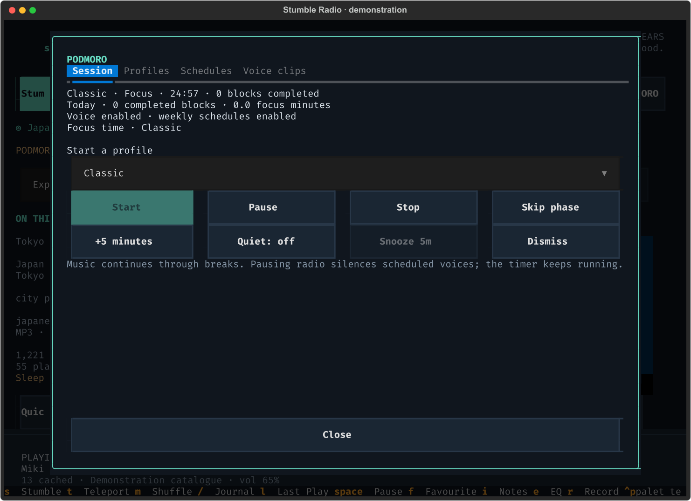
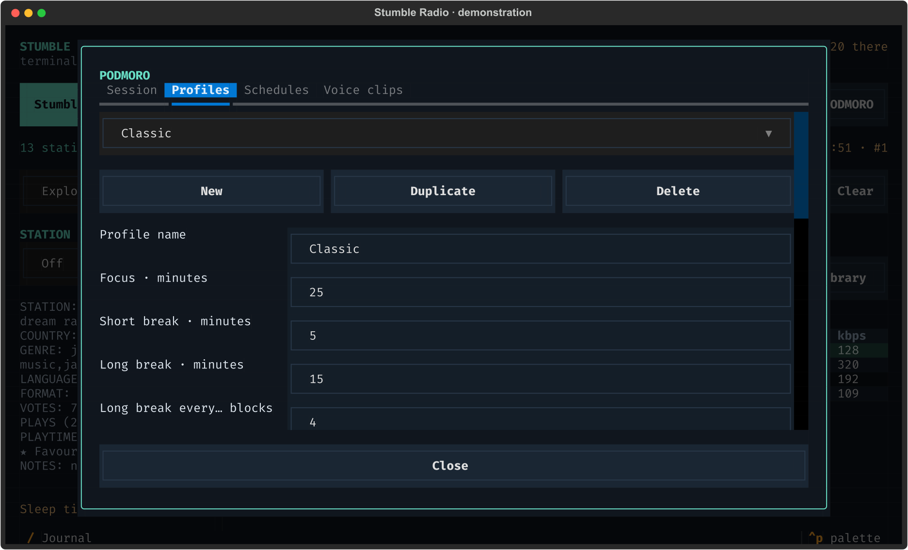
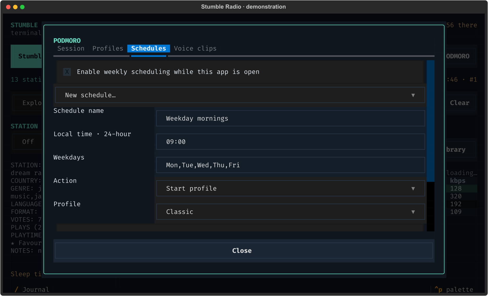
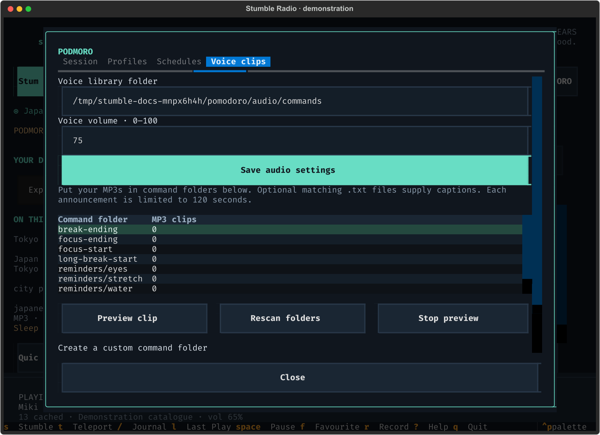
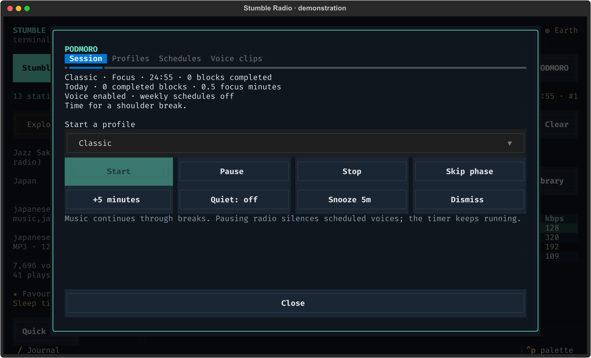

# PODMORO: focus, breaks and voice reminders

[← Stumble Radio](../README.md)

Screenshots show the actual interface with real stations and demonstration listening data.



Start a profile in Session. The countdown also stays on the main player after closing the modal. Start with the timer, then add your own voice clips when ready.

Jump to [sessions and profiles](#sessions-and-profiles), [weekly schedules](#weekly-schedules), [sound setup](#set-up-your-voice-library), or [audio and recovery behaviour](#audio-sleep-and-recovery-behaviour).

Open **PODMORO** at the right end of the transport row, or press **Ctrl+O**. The modal has four tabs:
**Session**, **Profiles**, **Schedules**, and **Voice clips**. Its countdown stays
visible above the station browser when you close the modal, and Quick tune sits
beside Search. On narrow terminals, the top controls
use two rows so PODMORO remains reachable at the right of the second row.

The scheduler is **off initially**. The included Classic profile uses 25 minutes
of focus, a 5-minute short break, and a 15-minute long break after four completed
focus blocks. It repeats until stopped. There are no bundled recordings: without
your MP3s, reminders appear visually and the timer still works.

## Sessions and profiles



Profiles keep timing and recurring reminders together. Scroll down for reminder controls and Save profile; changes apply to your next session.

Choose a profile in Session and press **Start**. Focus and break phases advance
automatically; radio music normally continues through both.

| Control | Behaviour |
| --- | --- |
| Pause / Resume | Freeze/resume the session clock and its interval reminders; pause dismisses speech |
| Stop | End the session silently; completed blocks and elapsed focus time remain in today's totals |
| Skip phase | Move to the next phase; skipping focus does not award a completed block |
| +5 minutes | Extend the current phase, up to 24 hours remaining |
| Quiet | Silence scheduled voices without stopping the timer or visual reminders |
| Snooze 5m | Repeat the latest reminder in five active minutes; unavailable for phase announcements |
| Dismiss voice | Stop the current announcement and clear its displayed message |
| Rearm schedules | Resume a scheduler suspended by the sleep timer |

In Profiles, create, duplicate, rename, save, or delete profiles. Durations can be
1–720 minutes, long breaks occur after 1–100 completed focus blocks, and the block
limit can be 0–1000. Zero repeats indefinitely; a nonzero limit finishes the
session immediately after its final focus block, without adding another break.

Optional **focus-ending** and **break-ending** warnings use seconds before the
phase deadline. Zero disables them, and a warning must be shorter than its phase
(a shared break warning must fit the shorter break). Editing a profile affects
the **next** session; the running session keeps a snapshot of its settings.
Profiles referenced by a schedule or the current session cannot be deleted until
those references are removed; at least one profile must remain.

To add an interval reminder, enter its command folder, interval, and eligible
phase, then **Add / update**. Select a reminder row with Enter to edit or remove
it; **New reminder** clears that selection. Intervals range from 1–1440 minutes.
For example, `reminders/stretch`, every `30`, during `Focus` counts only focus
minutes and carries that count across breaks. `Breaks` counts break time, and
`Either` counts both. Pausing the session stops those clocks.

Today's totals show completed focus blocks and elapsed focus minutes. These are
timer measurements, not a claim that attention or exercise was detected. Radio
pause and Quiet leave the focus clock running; use the scheduler's Pause when
you want its clock stopped too.

## Weekly schedules



The master checkbox and each rule must both be enabled. This example starts Classic at 09:00 on weekdays while Stumble Radio is open.

In Schedules, choose **New schedule**, enter a name and a local 24-hour time such
as `09:00`, and enter weekdays such as `Mon,Tue,Wed,Thu,Fri`. Numbers `0` through
`6` also work, with Monday as zero. Choose either:

- **Start profile:** select the profile to begin at that time.
- **Speak reminder:** enter a command folder such as `reminders/water`; no active
  focus session is required.

Save the rule and check **Enable weekly scheduling while this app is open**.
Each rule also has its own enabled switch. For example, a weekday 09:00 Classic
start and a weekday 13:00 water reminder can be independent rules.

Schedules use your system's local timezone and run **only while the TUI is open**.
They do not install a daemon, wake a closed application, or replay missed starts.
A scheduled start never replaces an active or paused session. Repeated local
times during a daylight-saving fallback fire once; nonexistent spring-forward
times are skipped. A processing/clock gap greater than 60 seconds pauses a running
session rather than racing through overdue phases and announcements.

## Set up your voice library



Copy the folder path shown in your own Voice clips tab. The counts here reflect
the demonstration clips loaded for this capture; a fresh installation starts at
zero because no audio ships with the app, and your MP3s will increase the counts.

### 1. Open the folders

Open **PODMORO → Voice clips**. Opening the modal creates the default command
folders. This tab shows the actual library path, including any custom data
directory. You can choose another writable folder and press **Save audio settings**.
Voice volume is separate from the radio volume and accepts 0–100.

With the default Linux data directory, the layout is:

```text
~/.local/share/stumble-radio/pomodoro/audio/commands/
  focus-start/
  focus-ending/
  short-break-start/
  long-break-start/
  break-ending/
  session-complete/
  reminders/
    water/
    stretch/
    eyes/
```

On macOS the default starts at
`~/Library/Application Support/stumble-radio/pomodoro/audio/commands/`.
`$XDG_DATA_HOME` and `--data-dir` can change the Linux location. Voice clips always
shows the selected path; `stumble-radio --doctor` prints the default path for the
chosen data directory.

### 2. Prepare short MP3s

Record your own prompts or export MP3s from your preferred voice-generation tool.
The app does not generate speech, download clips, or require a speech-service
account. `.mp3` and `.MP3` extensions are accepted. Use generic wording when the
same folder will serve profiles with different durations.

| Folder | When it is used | Example wording for your recording |
| --- | --- | --- |
| `focus-start` | At the beginning of each focus block | "Time to focus." |
| `focus-ending` | Before focus ends, if the profile's focus warning is enabled | "Your break is coming up." |
| `short-break-start` | At the start of a short break | "Take a short break." |
| `long-break-start` | At the start of a long break | "Time for a longer break." |
| `break-ending` | Before a break ends, if the profile's break warning is enabled | "Get ready to return." |
| `session-complete` | After the final focus block of a profile with a nonzero block limit | "Your session is complete." |
| `reminders/water` | When a reminder rule references this folder | "Time for some water." |
| `reminders/stretch` | When a reminder rule references this folder | Your own short stretch prompt |
| `reminders/eyes` | When a reminder rule references this folder | Your own short screen-break prompt |

The default ending warnings are **off**. Set warning seconds in Profiles to hear
those categories. Reminder folders also need a recurring or weekly rule; adding
an MP3 alone does not schedule it. There are no bundled exercise instructions.

### 3. Copy clips into their command folders

Drag and drop files using your file manager, or adapt this shell example. Replace
the first line with the path shown in **Voice clips**; the MP3s must already exist.

```bash
VOICE_LIBRARY='/path/shown/in/Voice clips'
mkdir -p "$VOICE_LIBRARY/focus-start" "$VOICE_LIBRARY/reminders/stretch"
cp ./ready.mp3 "$VOICE_LIBRARY/focus-start/ready.mp3"
cp ./shoulders.mp3 "$VOICE_LIBRARY/reminders/stretch/shoulders.mp3"
```

You can put several clips in one folder. The app chooses randomly and avoids an
immediate repeat when another clip is available. New files are discovered before
announcements; you do not need to restart.

### 4. Add optional captions

Place a UTF-8 `.txt` file next to an MP3, with the same basename:

```text
reminders/stretch/shoulders.mp3
reminders/stretch/shoulders.txt
```

For example, `shoulders.txt` might contain `Time for a shoulder break.` It supplies
the displayed caption; it is **not** converted to speech. Captions still appear
in Quiet mode or while radio is paused. Without a clip, the timer shows the
category/event label and continues visually.



Here a stretch reminder fires during a focus session and displays the caption
from the clip's `.txt` file; this example uses demonstration clips.

### 5. Rescan and test

In **Voice clips**, press **Rescan folders**, select a category row, and press
**Preview clip**. Check the count and voice volume. Preview is an explicit audio
action and plays even in Quiet mode or while radio is paused. **Stop preview**,
closing the modal, or radio Pause stops it.

Each clip is limited to **120 seconds**, so keep prompts short. An unreadable or
corrupt file produces an error and releases the radio mute. If there is no sound,
confirm mpv is installed, that the selected folder contains a real MP3, and that
the system and voice volumes are audible.

### 6. Connect reminders to your profile or calendar

For a recurring stretch prompt, open **Profiles**, select a profile, and scroll
to **Recurring reminders**. Enter `reminders/stretch`, an interval such as `30`,
and **Focus**, check **Reminder enabled**, then press **Add / update** and
**Save profile**. Start a new session with that profile. The counter advances
only during eligible time and carries across phases.

For a fixed-time prompt, open **Schedules**, choose **Speak reminder**, and enter
`reminders/water` or your custom category. Save the rule, enable it, and enable
weekly scheduling. A speak rule can run without a focus session.

For your own categories, use **Create a custom command folder** with a name such
as `reminders/my-stretch`. Folder names accept letters, digits, hyphens,
underscores and `/` between nested folders. Reference that relative folder in a
rule; filenames inside it can change freely. Keep referenced folder names stable.
Clips and category symlinks must resolve inside the selected library directory.

These folders can also hold your own short movement or exercise prompts. Ordered
multi-step routines, timed gaps between steps, and a routine editor are not yet
implemented.

## Audio, sleep, and recovery behaviour

Announcements use a separate mpv process. Radio is **muted, not retuned**, while
speech plays and returns to the live broadcast afterwards. Its user volume,
temporary voice mute, and sleep fade are combined, so volume changes, station
changes, and reconnects during speech do not undo the mute or restore an old level.

Manually pausing radio also silences scheduled voices; the timer and visual
reminders continue. Pausing the scheduler suppresses its speech too. Quiet is a
separate persistent preference. Network outages do not stop the local focus clock
or local voice files, provided you have not intentionally paused or silenced them.

Only one announcement plays at once. Phase announcements take precedence over
coincident reminders. Moving to a new phase discards stale in-session snoozes;
missed voices are not queued into a backlog when you unpause.

Voice audio never enters radio recordings or Last Play Search. Radio keeps
recording independently while muted, but voice-muted time is excluded from radio
listening totals. Songs announced by the station during speech are saved to Last
Play Search only if they are still current when audible radio resumes.

Sleep expiry stops speech, pauses the session, and suspends weekly triggers until
you manually Resume/Rearm them. Closing the app terminates voice playback and
saves a checkpoint. An interrupted session returns **paused**, without replaying
old speech. Profiles, rules, Quiet, library settings, daily totals, and checkpoints
are stored as a versioned `pomodoro_v1` record in the existing SQLite metadata
table; station/favourite/history tables are preserved. Checkpoints are saved on
controls, phase/calendar transitions, exit, and every 15 seconds while open. A
crash can lose up to roughly 15 seconds of timer progress.
