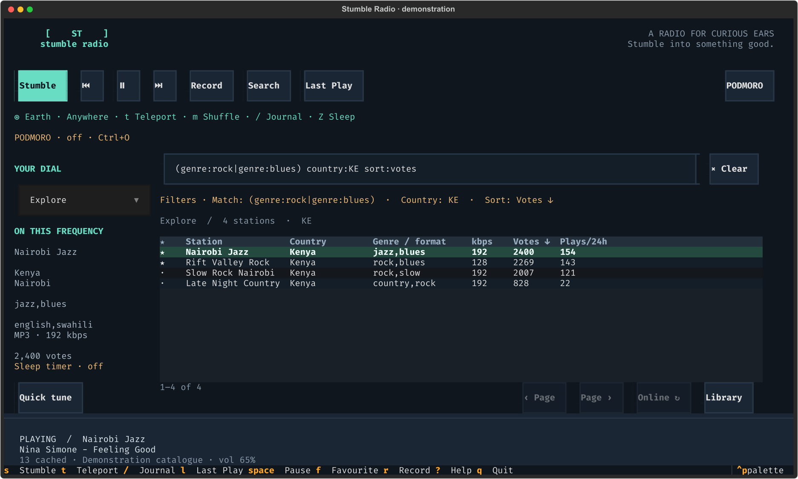
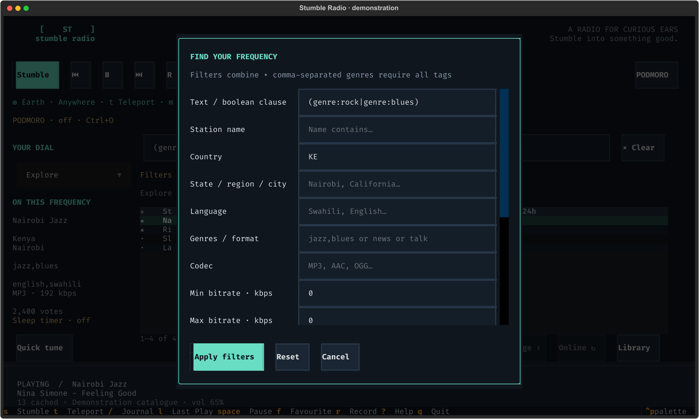

# Search, filters and sorting

[← Stumble Radio](../README.md)

Screenshots show the actual interface with fictional stations and demonstration listening data.



This query requires rock OR blues tags in Kenya. The filter summary explains the smaller result set. Matching starred stations lead the list, followed by the selected Votes sort.

Type a query directly into the main search bar. Results update as you type.
Plain words match **station names or genre/format tags**, case-insensitively.
Use `name:` when you want to search station names specifically. All the filters
from the advanced-search form have a corresponding query operator below.

```text
rock county:kenya
slow genre:rock
country|rock|blues country:kenya
country+rock country:kenya
```

`county:` is accepted as an alias for `country:`. In the third example, the plain
word `country` means the music/format keyword; `country:kenya` is the geographic
filter. Any of the three keywords may match, but the station must be in Kenya.
The fourth example requires **both** the `country` and `rock` keywords in Kenya.

## Connectors, phrases, and grouping

| Syntax | Meaning | Example |
| --- | --- | --- |
| A space | AND between clauses | `slow genre:rock country:KE` |
| `+` | Explicit AND | `country+rock country:KE` |
| `\|` | OR | `country\|rock\|blues country:KE` |
| `(…)` | Group conditions | `(rock\|blues)+slow country:KE` |
| `"…"` | Keep words together as a substring phrase | `"classic rock" country:US` |
| `field:"…"` | A field value containing spaces or literal operators | `name:"Rock + Blues"` |

**A space separates clauses that must all match. Within a clause, `+` binds more
tightly than `|`; parentheses override the grouping.** In particular:

```text
country|rock|blues country:kenya
# (country OR rock OR blues) AND country:kenya

slow+rock|news country:KE
# ((slow AND rock) OR news) AND country:KE

(slow|smooth)+(rock|blues) country:KE
# (slow OR smooth) AND (rock OR blues) AND country:KE
```

The `#` lines above are explanations, not text to paste into the search bar.
Spaces around an explicit connector are allowed: `rock | blues country:KE`
has the same meaning as `rock|blues country:KE`.

OR works with field filters as well as words. Repeat the field name on each
alternative:

```text
country:KE|country:UG genre:rock
language:english|language:swahili country:KE
genre:rock|genre:blues country:KE
(country:KE|country:UG) (genre:rock|genre:blues) codec:MP3
```

Use `genre:rock+genre:blues` or `genre:rock,blues` when both exact tags must be
present. A comma is the tag-list separator, not a general OR connector.

Double quotes preserve spaces and literal `+`, `|`, or parentheses. Apostrophes
inside names are ordinary characters: `name:"America's Country"` works. To search
literal text containing a colon, use `text:"Radio:Jazz"` or `name:"Radio:Jazz"`.
For an embedded double quote, escape it with a backslash, for example
`name:"The \"Jazz\" Station"`.

The supported boolean connectors are **`+` and `|`**, with spaces as implicit
AND. The words `AND` and `OR`, minus/NOT, wildcards, and regular expressions are
not special operators. Name and word searches are literal substring matches.

## Complete operator reference

Operator names are case-insensitive. Do not put a space after the colon unless
the value is enclosed in double quotes.

| Operator | Aliases | Meaning and examples |
| --- | --- | --- |
| Plain word / `text:` | — | Name-or-tag substring: `slow`, `"classic rock"`, `text:"Radio:Jazz"` |
| `name:` | — | Station-name substring: `name:"Capital FM"` |
| `country:` | `county:`, `countrycode:` | Exact country name or two-letter ISO code: `country:kenya`, `country:KE`, `country:"United Kingdom"` |
| `state:` | `region:`, `city:` | Region/state substring: `region:Nairobi`, `state:California`. City data depends on the directory; this does not geocode a place name. |
| `language:` | `lang:` | Language-name substring: `language:swahili`, `lang:english` |
| `tags:` | `tag:`, `genre:`, `genres:`, `tagList:` | Exact community tags; comma lists or repeated clauses require all: `genre:rock`, `tags:jazz,blues` |
| `codec:` | — | Codec substring: `codec:MP3`, `codec:AAC`, `codec:"AAC+"` |
| `bitrate:` | — | Exact kbps or inclusive range: `bitrate:128`, `bitrate:128..320`, `bitrate:128..`, `bitrate:..192`. Zero disables that bound. |
| `bitrate_min:` | `minbitrate:`, `bitrateMin:` | Minimum kbps: `minbitrate:128` |
| `bitrate_max:` | `maxbitrate:`, `bitrateMax:` | Maximum kbps: `maxbitrate:320` |
| `https:` | `https_only:` | `https:true` restricts to HTTPS streams; `https:false` removes that restriction. |
| `broken:` | — | `broken:true` includes failed/unchecked stations; `broken:false` hides them (the default). It does not select only broken stations. |
| `hidebroken:` | — | Inverse spelling of `broken:`: `hidebroken:false` includes failed checks. |
| `near:` | — | Centre latitude, longitude, radius **in kilometres**: `near:-1.2921,36.8219,50` |
| `lat:` | `latitude:` | Latitude; use together with longitude and radius: `lat:-1.2921` |
| `lon:` | `longitude:` | Longitude: `lon:36.8219` |
| `radius:` | `radius_km:` | Positive radius in kilometres: `radius:50` |
| `sort:` | `order:` | Sort field; see values below: `sort:votes`, `sort:name` |
| `direction:` | `dir:` | `direction:asc` or `direction:desc` |
| `reverse:` | `descending:` | Boolean spelling of direction: `reverse:true` means descending. |

Boolean values accept `true`/`false`, `yes`/`no`, or `1`/`0`.

`sort:` values are `plays` (also `clicks` / `clickcount`), `votes`, `name`,
`country`, `genre` (also `tags`), `bitrate`, `favourites` (also `favorites`,
`favourite`, `star`), and `recent` (your most recently played stations).
Text columns default to ascending; numeric sorts, favourites, and recent default
to descending. `direction:` overrides the default.

Sorting and health visibility are query-wide options. Keep `sort:`, `direction:`,
`reverse:`, `broken:`, and `hidebroken:` outside OR groups. Separate `lat:`,
`lon:`, and `radius:` must appear together as query-wide clauses; use a complete
`near:` condition inside a boolean group instead. For example:

```text
(near:-1.2921,36.8219,50|country:UG) genre:news sort:votes
```

Single-valued filters cannot be repeated in the same AND clause; use OR for
alternatives. For example, write `country:KE|country:UG`, rather than two separate
country clauses. Tags may repeat because they accumulate as an AND list.

## More combinations

```text
# Slow rock stations in Kenya, most voted first
slow genre:rock country:KE sort:votes

# Country, rock, or blues in Kenya, popular first
country|rock|blues country:kenya sort:plays

# Both country and rock keywords, in Kenya
country+rock country:kenya

# Rock OR blues in Kenya OR Uganda, English-language, 128–320 kbps
(genre:rock|genre:blues) (country:KE|country:UG) lang:english bitrate:128..320

# Swahili news or talk in Nairobi
(genre:news|genre:talk) country:KE region:Nairobi language:swahili

# High-bitrate HTTPS jazz, alphabetical by station
genre:jazz codec:MP3 minbitrate:192 https:true sort:name

# A station-name phrase, including stations with failed checks
name:"Radio Citizen" country:KE broken:true

# Nearby stations, using either geographic spelling
near:-1.2921,36.8219,50 genre:news
lat:-1.2921 lon:36.8219 radius:50 genre:news

# Votes ascending, with favourites still grouped first
country:KE sort:votes direction:asc
```

Paste the query lines, without the explanatory `#` lines.

## Search form, errors, online results, and sorting



The form and the bar describe the same query. Applying the form writes every restriction back to the bar; × Clear removes the query and its filters. The form scrolls to reach the remaining fields.

**Ctrl+F** opens the same filters as a form. Its Text / boolean clause field can
hold phrases and boolean groups; the other fields add AND restrictions. Applying
the form writes an equivalent query back into the search bar. Aliases and
connectors may be normalised, but their meaning stays the same. Editing/removing
an operator in the bar edits/removes that filter; there are no hidden form filters.

Incomplete quotes, missing values, unmatched parentheses, unsupported operators,
invalid bitrate ranges, and incomplete coordinates show an inline error. The
previous valid results remain visible. Online search, Stumble, and Teleport wait
until you fix or clear the invalid query. **× Clear** removes the entire query,
all constraints, and pagination; it keeps the selected library and shuffle mode.

The query applies to the **whole cached catalogue before sorting and pagination**,
not just the page on screen. It also constrains Stumble. Radio Browser does not
offer this complete boolean syntax, so online refresh fetches bounded candidate
pages and SQLite applies the full expression. A refresh can issue up to eight
requests of 100 candidates each, with duplicates merged. Larger expressions fall
back to a broader candidate page. Refresh again for the next page of candidates,
or let catalogue sync finish for complete local results. A small candidate batch
may not contain every match yet.

Click **★, Station, Country, Genre / format, kbps, Votes, or Plays/24h** to sort
the whole result list by that column. Click again to reverse it; the arrow shows
the active direction. Text columns begin A–Z and numeric columns highest first.
Matching favourites remain ahead of other results for these sorts. Clicking
**★** explicitly toggles favourites first/last, with names alphabetised within
each group. Genre sorting uses the station's complete tag string. The selected
sort appears in the query/filter summary, and sorting returns to page one.
History starts with recently played stations but can be re-sorted with any header.

## Advanced-form examples

Form fields combine with **AND**. Empty fields are unrestricted. Most text filters
match a case-insensitive substring; country is an exact name or exact ISO code.

| Find | Filters |
| --- | --- |
| Kenyan stations | Country: `KE` or `Kenya` |
| Swahili news in Kenya | Country: `KE`, Language: `swahili`, Genres: `news` |
| Regional stations | Country: `US`, State/region: `California` |
| Jazz with blues | Genres: `jazz,blues` (requires **both** exact tags) |
| Talk radio | Genres: `talk` |
| Higher bitrate MP3 | Codec: `MP3`, Min bitrate: `128` |
| Popular stations | Sort: Plays (24h), Descending checked |
| Alphabetical stations | Sort: Name, Descending unchecked |
| Stations within 50 km of Nairobi | Latitude: `-1.2921`, Longitude: `36.8219`, Radius: `50` |

Use **Apply filters** to search locally. **Reset** clears the search. Edit the main
query to narrow results without reopening the dialog. The form validates
bitrate ranges and requires all three geographic fields together.

Active advanced filters stay visible beneath the search bar, including country,
region, language, genres, codec, bitrate, radius, HTTPS, health, and non-default
sorting and boolean groups. This explains why a result list is restricted. The compact **× Clear**
button resets all search fields and sort choices, clears the query input, and
returns to the first page. It keeps your selected library and shuffle mode.

## Directory data limitations

- **Plays (24h)** is Radio Browser's recent click count; it is **not concurrent
  listeners**. The directory does not expose a reliable live listener count.
- Tags, languages, and regions are community supplied. For instance, `hip hop`,
  `hip-hop`, and `hiphop` may describe different sets of stations.
- The region field sometimes includes a city, but it is not a general address
  search. There is no built-in geocoder. Use explicit coordinates for radius search.
- Radius matches include only stations with coordinates; many do not have them.
  Results follow the selected sort, rather than distance from the search centre.
- A station that passed its last health check can still fail now. Favourites and
  history include saved stations even if they are now marked broken or removed.
- History is written when mpv reports that a stream loaded. It stores up to 5,000
  play events; the History view shows each station once, favourites first and then
  most recently played within each group by default. Clicking a header changes that sort.
  Unheard uses the persistent per-station play totals, including imported older history.
